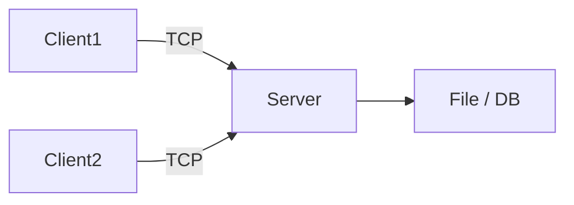

# Architecture client-serveur (concepts et patterns)

Objectif: donner une vision d'ensemble sur comment organiser une application réseau basique, protocoles applicatifs, et critères de conception.

Principes
- Séparer logique applicative et logique réseau
- Définir un protocole simple (ligne par ligne, JSON, ou binaire structuré)
- Gérer l'authentification minimalement (pseudo dans un tchat)
- Prévoir gestion d'états (liste des clients, rooms)

Pattern simple pour un chat
- Serveur central qui accepte connexions et propage messages
- Protocole: chaque message = `[timestamp]pseudo:texte\n`
- Sauvegarde: append texte dans un fichier (rotation si trop grand)

Diagramme (mermaid)

Critères d'acceptation (exemple de projet chat)
- Le serveur accepte plusieurs clients simultanément
- Les messages envoyés par un client sont reçus par tous
- Les clients peuvent se déconnecter proprement
- Documentation: protocole et commandes disponibles

Exercice
- Décrire le protocole minimal pour un jeu en ligne simple (pile/face en réseau). Quelle commande envoyer pour commencer une partie ?
